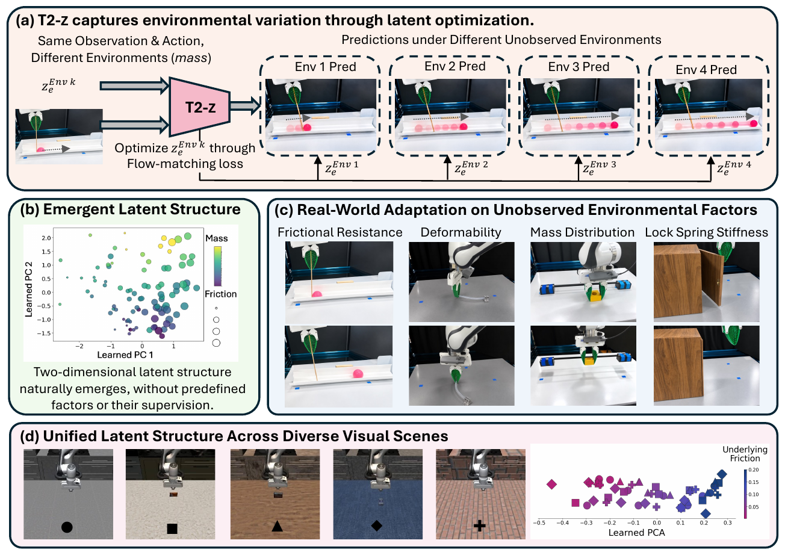

<h1 align="center">T2-z: Test-Time Optimization of Environment Latents<br>for Robotic World Models</h1>

<p align="center">
  
  <a href="https://t2-z-latent-optimization.github.io/"></a>
  <a href="https://huggingface.co/datasets/huagailuowen/T2-z-datasets"></a>
  <a href="LICENSE"></a>
</p>

<p align="center">
  Chenyuan Zhou<sup>1*</sup>, Yining Hong<sup>1*</sup>, Huang Huang<sup>1‡</sup>, Yunfan Jiang<sup>1‡</sup>, Wenlong Huang<sup>1‡</sup>, David Held<sup>2</sup>,<br>
  Vitor Campagnolo Guizilini<sup>3</sup>, Yue Wang<sup>4</sup>, Li Fei-Fei<sup>1</sup>, Jiajun Wu<sup>1</sup>, Leonidas Guibas<sup>1†</sup>, Yejin Choi<sup>1†</sup>
</p>

<p align="center">
  <sup>1</sup> Stanford &nbsp; <sup>2</sup> Amazon &nbsp; <sup>3</sup> Toyota Research Institute &nbsp; <sup>4</sup> University of Southern California<br>
  <sup>*</sup> Equal contribution &nbsp; <sup>‡</sup> Joint second authors &nbsp; <sup>†</sup> Equal advising
</p>

<p align="center">
  
</p>

## Overview

**T2-z** enables robotic world models to adapt to unobserved environmental factors,
from physical properties such as friction and mass to interaction rules, through
a compact, learnable **32-dimensional environment latent**. The latent captures
environmental variation without supervision of which factors exist or what values
they take.

During training, randomly initialized environment latents and a shared world model
are optimized in alternation: world-model updates keep the latents fixed, while
environment-latent updates freeze the world model. At test time, a newly initialized
latent is optimized from one or more **test-time interaction trajectories**, with
the world model frozen. The adapted latent then conditions video predictions for
new actions in the same environment.

Across **seven simulated settings and four real-world robotic tasks**, T2-z
improves world prediction and downstream action selection. Its learned latents
exhibit structured variation across individual and compounded environmental
factors. See the [project page](https://t2-z-latent-optimization.github.io/) for
videos, qualitative comparisons, and experimental results.

---

## Installation

Run the following commands from the repository root on Linux. Training and GPU
inference require an NVIDIA driver compatible with CUDA 12.8. The commands below
install the CUDA 12.8 PyTorch build from the official PyTorch index.

```bash
curl -LsSf https://astral.sh/uv/install.sh | sh
export PATH="$HOME/.local/bin:$PATH"
uv venv --python 3.11
source .venv/bin/activate
uv pip install --default-index https://download.pytorch.org/whl/cu128 \
  torch==2.8.0 torchvision==0.23.0 torchaudio==2.8.0
uv pip install --default-index https://pypi.org/simple -r requirements.txt
```

See the [uv installation guide](https://docs.astral.sh/uv/getting-started/installation/)
for other installation methods.

Datasets and weights are not included in the code archive. Prepare each task's
dataset in the following layout:

```text
datasets/<task>/
  train.jsonl
  sampling.json
  action_stats.json
  data/
```

The Quick Start below downloads the pretrained Wan2.2-TI2V-5B model files to
`models/Wan2.2-TI2V-5B/` and the BWM initialization checkpoint to
`ckpt/BLM/step-12000.safetensors`.
Alternative locations can be set through `model_paths` and `ckpt_path` in the
task YAML. The model file layout is defined in
`configs/model/wan2_2_ti2v_5b.yaml`.

Online simulation additionally requires the
[simulator dependencies](wan_video_action/evaluation/sim_action_selection/docs/simulator_dependency_setup.md).

## Quick Start

### Download Datasets

The [training datasets](https://huggingface.co/datasets/huagailuowen/T2-z-datasets)
are available as browsable task directories and a lossless ZIP archive. Download
and prepare all tasks in the repository's `datasets/` layout:

```bash
uv pip install --default-index https://pypi.org/simple \
  "huggingface_hub[cli]>=0.34,<1.0"
python scripts/download_datasets.py
```

The script downloads and extracts the ZIP automatically. It does not overwrite
an existing destination.

### Download Pretrained Weights

With the environment above activated, download the complete
[Wan2.2-TI2V-5B base model](https://huggingface.co/Wan-AI/Wan2.2-TI2V-5B)
and the official
[BWM initialization checkpoint](https://huggingface.co/BLM-Lab/Boundless-World-Model).
Both are required; the BWM checkpoint does not replace the base model files.

```bash
mkdir -p models/Wan2.2-TI2V-5B ckpt/BLM
hf download Wan-AI/Wan2.2-TI2V-5B \
  --local-dir models/Wan2.2-TI2V-5B
hf download BLM-Lab/Boundless-World-Model step-12000.safetensors \
  --local-dir ckpt/BLM
```

With the datasets and weights downloaded, start training below.

### Training

Entry: `t2z/train.py`. Ours task configurations are in `configs/ours/`.
For example, with the Friction dataset and weights prepared:

```bash
TASK=sim_pushbox_friction
python t2z/train.py --config "configs/ours/${TASK}.yaml" --check-data
bash "launch/train_ours_${TASK}.sh"
```

`--check-data` checks the configured dataset without starting GPU training.
The launcher uses the task's default GPU count; override it with
`T2Z_NUM_PROCESSES` when needed. Outputs default to `outputs/<task>/<method>/`.

Baseline training uses the same entry:

```bash
METHOD=standard
accelerate launch --num_processes 2 t2z/train.py \
  --method "$METHOD" \
  --config "configs/baselines/${METHOD}/${TASK}.yaml"
```

Training methods: `ours`, `standard`, `dino`, `ttt`. Use the GPU count specified
for the selected task.

### Inference

Entry: `t2z/infer.py`. Task configurations are in `configs/inference/`.
Supply metadata containing the support and query chunks, and select their
zero-based row indices explicitly. Support and query indices should be disjoint
and belong to the corresponding environment.

```bash
TASK=sim_pushbox_friction
CHECKPOINT=/path/to/trained_checkpoint.safetensors
CONTEXT_TABLE=/path/to/matching_context_table.json
METADATA=/path/to/metadata.jsonl
SUPPORT_INDICES=0
QUERY_INDICES=1

python t2z/infer.py --method ours \
  --config "configs/inference/${TASK}.yaml" \
  --checkpoint "$CHECKPOINT" \
  --context-table "$CONTEXT_TABLE" \
  --metadata "$METADATA" \
  --support-indices "$SUPPORT_INDICES" \
  --query-indices "$QUERY_INDICES" \
  --output "outputs/infer_${TASK}_ours"
```

For baselines, omit `--context-table` and use the corresponding checkpoint:

```bash
METHOD=standard
python t2z/infer.py --method "$METHOD" \
  --config "configs/inference/${TASK}.yaml" \
  --checkpoint "$CHECKPOINT" \
  --metadata "$METADATA" \
  --support-indices "$SUPPORT_INDICES" \
  --query-indices "$QUERY_INDICES" \
  --output "outputs/infer_${TASK}_${METHOD}"
```

Inference methods: `ours`, `standard`, `dino`, `ttt`, `lora`.
LoRA adapts a trained Standard checkpoint at inference time.

---

## Citation

If you find T2-z useful in your research, please cite:

```bibtex
@misc{zhou2026t2z,
  title  = {{T2-z}: Test-Time Optimization of Environment Latents for Robotic World Models},
  author = {Zhou, Chenyuan and Hong, Yining and Huang, Huang and Jiang, Yunfan
            and Huang, Wenlong and Held, David and Guizilini, Vitor Campagnolo
            and Wang, Yue and Li, Fei-Fei and Wu, Jiajun and Guibas, Leonidas
            and Choi, Yejin},
  year   = {2026},
  url    = {https://t2-z-latent-optimization.github.io/}
}
```

## License

This repository is licensed under the [Apache License 2.0](LICENSE).
Third-party dependencies, pretrained models, and datasets remain subject to
their respective licenses and terms.
